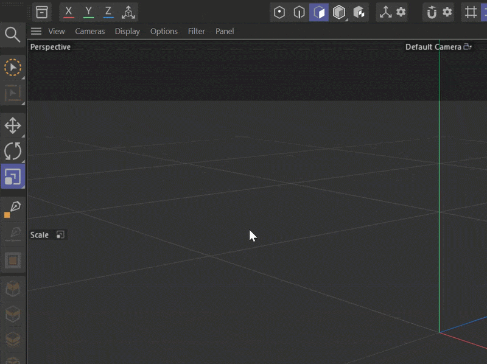

# C4D_PieMenu — Radial Marking Menu & Profile Editor for Cinema 4D



**C4D_PieMenu** is a fast, highly customizable radial marking menu (pie menu) plugin for Maxon Cinema 4D (supporting Cinema 4D 2025 and 2026). It brings rapid gesture-based tool and command execution directly under your mouse cursor (**Press & Flick**), alongside an interactive graphical profile editor with full **Drag & Drop** command assignment.

---

## Key Features

### 1. Zero-Latency Viewport HUD & Marking Menu
- **Hardware-Accelerated Overlay**: Uses a dedicated transparent double-buffered Win32 overlay with GDI+ anti-aliasing, ensuring smooth, instantaneous opening with zero viewport stutter.
- **Press & Flick Gesture**: Press and hold your designated menu hotkey, flick the mouse toward the desired slice, and release the key — the command fires instantly without requiring extra clicks.
- **Click Confirmation & Escape**: Supports traditional left-click (LMB) confirmation or right-click (RMB) / `Esc` to dismiss without executing.
- **Smart Input Detection**: Automatically pauses menu activation when typing in text fields, numeric attributes, console inputs, or renaming objects in Cinema 4D to prevent accidental triggers.
- **Center Hub Slot**: The central deadzone doubles as a dedicated hub slot (e.g. for Undo, Reset, or Deselect).
- **Modern Annular Aesthetics**:
  - Smooth annular arc segments with hover popout expansion.
  - Directional laser pointer guideline connecting the hub to the cursor.
  - Prominent glowing accent highlights for the hovered slot.
  - Deadzone crosshair reticle.
  - Optional profile title badge above the menu.
  - **Inactive Slots as Gaps**: Inactive or unassigned slots can appear as clean gaps, keeping your most-used commands clearly separated and easy to hit.

- **Modifier Keys Support (Alt, Shift, Ctrl)**:
  - **Native C4D Modifier Behaviors**:
    - **Alt**: Automatically nests selected objects as children of the newly created generator/primitive (e.g. Subdivision Surface, Null, Boole) with bounding-box matching and undo integration.
    - **Shift**: Automatically nests the newly created deformer/object as a child of selected objects with local transform reset; for interactive modeling tools (e.g. Extrude, Bevel), instantly opens their tool options dialog.
    - **Ctrl**: Spawns newly created objects directly at the world origin `(0, 0, 0)`.
  - **Custom Modifier Actions Override**: Assign distinct alternative Cinema 4D commands for `Shift`, `Ctrl`, and `Alt` to any slot (radial or center hub).
  - **Live Dynamic HUD Feedback**: Holding modifier keys while the menu is open updates slot icons and titles in real time and displays an active modifier badge (`[ALT: Parent]`, `[SHIFT: Child / Options]`, `[CTRL]`).

- **Nested Submenus Support**: Any slot (radial or central) can be linked to another created Pie Menu profile:
  - **Press & Flick into Submenu**: Hovering over a submenu slot instantly expands the submenu centered under your cursor (zero delay); continue flicking to execute the desired command in one fluid stroke!
  - **Click Navigation**: Click or release on a submenu slot to pin it open and browse choices.
  - **Breadcrumbs Badge**: Displays hierarchy at the top (e.g. `[Modeling > Tools > Extrude]`).
  - **Intuitive Back Navigation**: Inside any submenu, click RMB, press `Backspace`, or click the center hub (`Back`) to return to the parent menu. Esc or RMB at root cancels.

### 2. Unlimited Context-Aware Profiles
- **Create Unlimited Menus & Submenus**: Add as many custom pie menus as you need using the **`+ New Menu`**, **`Duplicate`**, and **`- Delete`** buttons. Menus can be used standalone or linked as submenus in other menus.
- **Context-Sensitive Triggering**:
  - **Global**: Accessible across all modes and tools.
  - **Polygons Mode**: Active when working in polygon component mode.
  - **Edges Mode**: Active when working in edge component mode.
  - **Points Mode**: Active when working in point component mode.
  - **Objects / Model Mode**: Active in standard object or model mode.
  - **UV Edit Mode**: Active within UV editing workflows.
- **Individual Per-Menu Hotkeys**: Assign any key combination to each menu:
  - Modifiers: `Ctrl`, `Shift`, `Alt`.
  - Keys: Any standard key (e.g., `V`, `Tab`, `C`, `Space`, function keys, numbers, etc.) with interactive key recording via the **`Press Key...`** button.
- **Smart Conflict Resolution**: If multiple menus share the same hotkey, the plugin dynamically activates the menu that best matches your current document editing context, seamlessly falling back to Global if no mode-specific menu matches.

### 3. Visual Configuration Dialog (Extensions -> Pie Menu Configuration)
- **Built-in Command Palette & Submenu Library (2-Tab Left Column)**:
  - **C4D Commands Tab**: Live search through all Cinema 4D built-in tools, commands, and third-party plugins by name or command ID.
  - **Submenus Tab**: Browse all created profiles with item count and context badges. Double-click or drag any menu onto a pie slot to link it as a submenu! Includes `+ New Submenu` and `Assign to Slot` buttons.
- **Drag & Drop Assignment & Slot Rearrangement**:
  - Drag commands or submenus directly onto radial slots or the slot inspector.
  - **Drag & Drop with Modifiers**: Hold `Shift`, `Ctrl`, or `Alt` while dragging to assign commands directly to that modifier action.
  - **Drag & Drop Slot Reordering**: Freely click and drag slots directly on the pie canvas to swap or move them to different positions. Hold `Ctrl` while dragging to duplicate a slot.
  - Double-clicking a command or submenu assigns it to the active slot.
- **Interactive Radial Canvas**: Real-time visual canvas displaying dynamic 2 to 24 slot layouts, icons, labels, accent colors, submenu indicators (`>`), and gap distribution. Selected slot glows with its custom accent color. Dynamic visual swap link and gold highlight during slot dragging.
- **Detailed Slot Inspector**:
  - **Submenu Link Dropdown**: Select any existing menu to link as a submenu, with an **`Edit Menu ->`** button to jump straight to editing that submenu.
  - Custom Command ID or name.
  - **Dedicated Modifier Actions**: Inspect and customize `Shift`, `Ctrl`, and `Alt` actions with one-click **`Set Sel`** (captures selected palette command) and **`Reset`** buttons.
  - Custom Label overrides.
  - Custom Accent Color picker per slot.
  - Enable / Disable slot toggle.
  - One-click *Clear Slot*.
- **Display & Sizing Controls (Per-Menu & Global)**:
  - **Per-Menu Display Style**: Choose between *Icon and Label*, *Icon Only* (minimalist HUD with glowing icons), or *Label Only* (classic text menu) individually for each pie menu profile.
  - **Per-Menu Icon Size**: Customize icon size in pixels (12px to 64px) individually per menu.
  - Adjustable Outer Radius and Deadzone Radius.
  - **Dynamic Slot Count**: Adjust radial slice count from 2 up to 24 items using an interactive numeric slider with real-time preview.
  - Toggle *Show Menu Title* badge.
- **Import & Export Settings**:
  - **Export Settings...**: Export either all menu profiles and global radius/deadzone settings or only the active menu profile to readable `.json` files (includes full submenu hierarchies).
  - **Import Settings...**: Seamlessly load configuration from `.json` or binary `.dat` files with interactive prompt to either Replace all menus or Append/Merge new menus into your current configuration.
- **Auto-Save & Configuration**:
  - Automatically saves all profile changes when closing the dialog or modifying settings.
  - Stored in Cinema 4D user preferences (`piemenu_profiles.dat`).

---

## Controls & Gestures

| Action / Gesture | Description |
|---|---|
| **Hold Configured Hotkey** | Instantly opens the radial pie menu under the cursor |
| **Move Mouse** | Highlights the targeted slot with popout and laser pointer |
| **Release Hotkey** | Executes the active slot command immediately (**Press & Flick**) |
| **Hold Alt while executing** | Makes new generator/object parent of selection (or custom Alt action) |
| **Hold Shift while executing** | Makes new deformer child of selection, or opens tool options (or custom Shift action) |
| **Hold Ctrl while executing** | Places newly created object at world origin (or custom Ctrl action) |
| **Hover Submenu Slot** | Instantly expands submenu under cursor (zero delay); flick into any submenu command |
| **LMB Click** | Executes command, or pins and opens a submenu slot |
| **Center Hub (`Back`)** | In submenu: returns to parent menu |
| **`Backspace` / RMB in Submenu** | Returns back to parent menu |
| **RMB Click at root or `Esc`** | Cancels and closes the menu without executing |

---

## Installation

1. Download or extract the release archive (`C4D_PieMenu_v<version>.zip`).
2. Copy the `C4D_PieMenu` folder corresponding to your Cinema 4D version (`2025` or `2026`) into your Cinema 4D plugins directory:
   - **User Plugins folder (Recommended)**:
     ```text
     %APPDATA%\Maxon\Maxon Cinema 4D <Version>_<Hash>\plugins\C4D_PieMenu
     ```
   - **Application Plugins folder**:
     ```text
     <Cinema 4D Installation Directory>\plugins\C4D_PieMenu
     ```
3. Launch or restart Cinema 4D.
4. Access the configurator via the main menu: **Extensions** -> **Pie Menu Configuration**.
